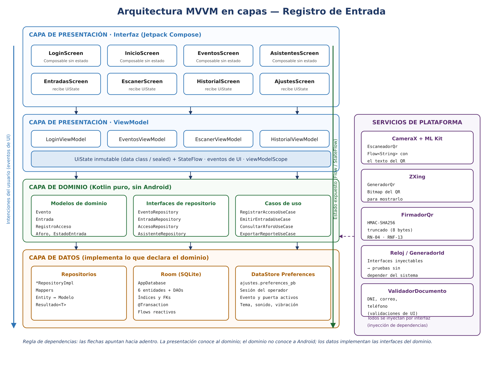
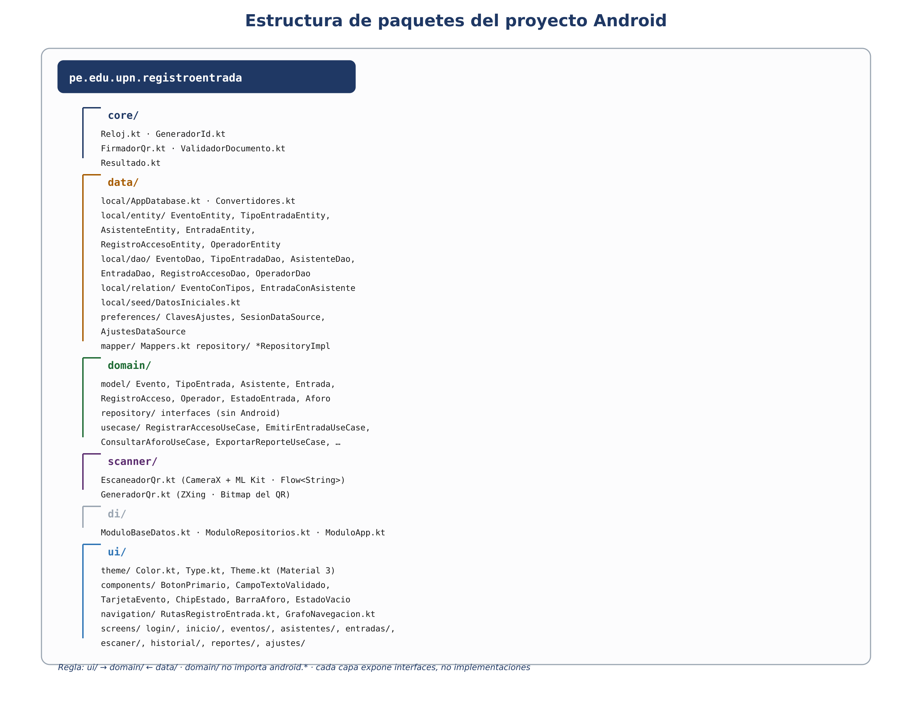
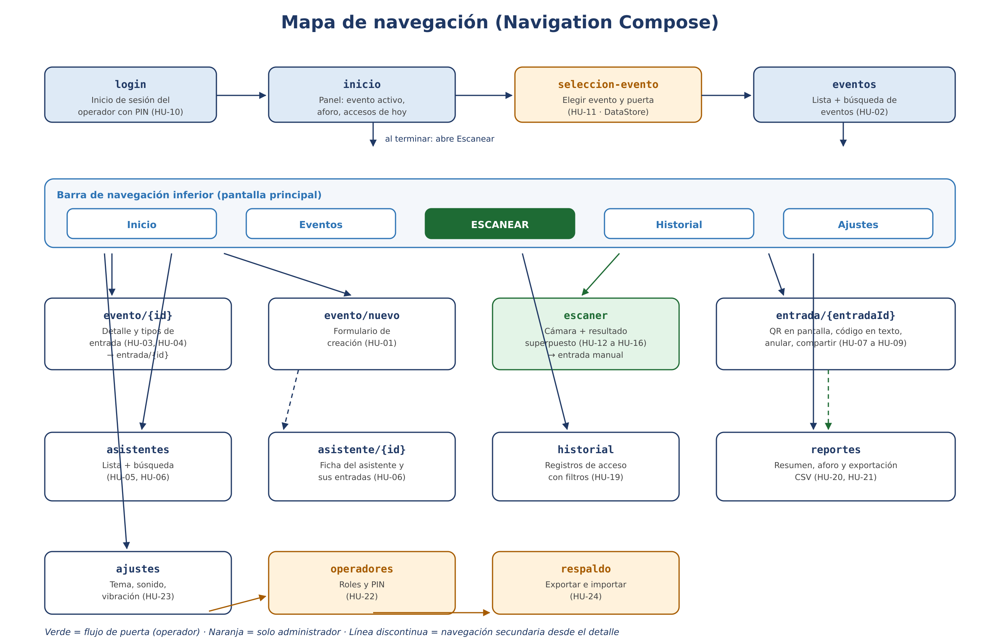
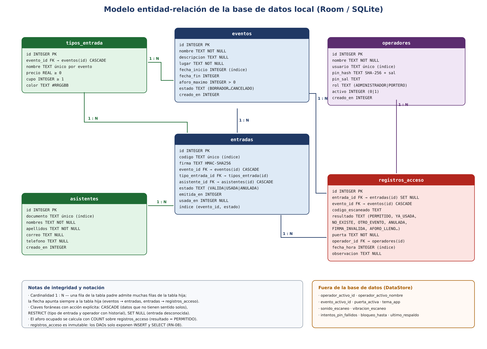
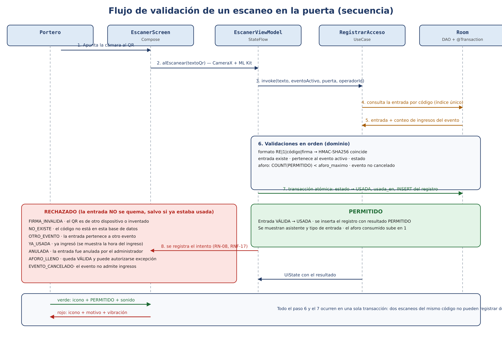

```{=openxml}
<w:p><w:r><w:br w:type="page"/></w:r></w:p>
```

# Parte 7. Arquitectura MVVM y diseño del modelo de datos local

Este apartado es el **diseño técnico** que se entrega en la Práctica de Campo 05 y que se implementa en las prácticas 06 (interfaz y navegación) y 07 (persistencia local). Su objetivo es que el código de los siguientes sprints sea la traducción directa de este documento.

## 7.1. Visión general de la arquitectura

Se usa **MVVM con arquitectura en capas** y **flujo de datos unidireccional (UDF)**:

- **Presentación (View + ViewModel)**: las pantallas de Jetpack Compose son funciones *stateless* que reciben un estado inmutable (`UiState`) y emiten eventos hacia el `ViewModel`. El `ViewModel` expone el estado con `StateFlow`, ejecuta los casos de uso en corrutinas y sobrevive a los cambios de configuración.
- **Dominio**: contiene los modelos de negocio, las interfaces de repositorio y los **casos de uso** que representan las reglas de negocio (RN-01 a RN-15). No conoce Android.
- **Datos**: implementa las interfaces de repositorio. Usa **Room (SQLite)** para los datos de negocio y **DataStore Preferences** para la configuración y la sesión. Convierte entre entidades de base de datos y modelos de dominio con *mappers*.



*Figura 1. Arquitectura MVVM en capas de Registro de Entrada*

**Regla de dependencias (importante para la evaluación)**: las flechas de dependencia apuntan **hacia adentro**. La capa de presentación conoce al dominio; el dominio no conoce a nadie; la capa de datos implementa las interfaces que declara el dominio. Esto permite sustituir Room por otra fuente de datos (por ejemplo, un servidor futuro) sin tocar los `ViewModel`.

### 7.1.1. Responsabilidades de cada capa

| Capa | Paquete | Qué contiene | Qué NO debe contener |
|---|---|---|---|
| Presentación | `ui/` | Composables, `ViewModel`, `UiState`, navegación, tema, componentes reutilizables | Consultas SQL, acceso directo a `Room` o `DataStore`, reglas de negocio |
| Dominio | `domain/` | Modelos de dominio, interfaces de repositorio, casos de uso, validaciones | Nada de `import android.*`, nada de `Entity` o `Dao` de Room |
| Datos | `data/` | Entidades, DAOs, `AppDatabase`, `DataStore`, mappers, implementaciones de repositorio | Referencias a Compose o a `ViewModel` |
| Servicios de plataforma | `scanner/`, `core/` | Escaneo QR con CameraX + ML Kit, generación de QR, fecha/hora, generación de identificadores, firma | Lógica de negocio repetida de los casos de uso |
| Inyección de dependencias | `di/` | Módulos que proveen base de datos, repositorios y servicios | Construcción manual de dependencias dentro de las pantallas |

### 7.1.2. Flujo unidireccional de datos (ejemplo concreto)

1. La pantalla `EscanerScreen` dibuja lo que dice `EscanerViewModel.estado.value`.
2. El usuario apunta la cámara; el servicio `EscaneadorQR` emite el texto leído.
3. La pantalla llama a `viewModel.alEscanear(texto)`; **nunca** ejecuta lógica.
4. El `ViewModel` llama a `RegistrarAccesoUseCase(texto, eventoActivoId, puerta, operadorId)` dentro de `viewModelScope`.
5. El caso de uso valida la firma, consulta el repositorio y ejecuta la transacción.
6. El repositorio lee y escribe en Room y devuelve un `Resultado<RegistroAcceso>`.
7. El `ViewModel` transforma el resultado en un `EscanerUiState` nuevo y lo publica.
8. Compose recompone y muestra el resultado en pantalla (verde/rojo, texto, sonido, vibración).

```kotlin
// Presentación: estado inmutable y eventos explícitos
data class EscanerUiState(
    val escaneando: Boolean = false,
    val resultado: ResultadoEscaneo? = null,
    val errorPermiso: Boolean = false,
    val totalIngresados: Int = 0,
    val aforoMaximo: Int = 0
)

sealed interface EventoEscaner {
    data class QrDetectado(val texto: String) : EventoEscaner
    data class CodigoManual(val codigo: String) : EventoEscaner
    data object LimpiarResultado : EventoEscaner
}
```

```kotlin
// Dominio: el caso de uso concentra la regla de negocio RN-01, RN-04, RN-05 y RN-09
class RegistrarAccesoUseCase(
    private val entradas: EntradaRepository,
    private val accesos: AccesoRepository,
    private val eventos: EventoRepository,
    private val firmador: FirmadorQr,
    private val reloj: Reloj
) {
    suspend operator fun invoke(
        textoQr: String,
        eventoActivoId: Long,
        puerta: String,
        operadorId: Long
    ): RegistroAcceso
}
```

## 7.2. Estructura de paquetes del proyecto Android



*Figura 2. Estructura de paquetes del código fuente*

```
pe.edu.upn.registroentrada
├── RegistroEntradaApp.kt          // Application: inicializa la inyección de dependencias
├── MainActivity.kt                // Único Activity: aloja el NavHost de Compose
├── core/                          // Utilidades transversales
│   ├── Reloj.kt                   // Interfaz Reloj + RelojSistema (facilita pruebas)
│   ├── GeneradorId.kt             // UUID v4 inyectable
│   ├── FirmadorQr.kt              // HMAC-SHA256 truncado (RN-04, RNF-13)
│   ├── ValidadorDocumento.kt      // DNI/CE (8 dígitos), correo, teléfono
│   └── Resultado.kt               // Éxito / Error con mensaje en español
├── data/
│   ├── local/
│   │   ├── AppDatabase.kt         // @Database(version = 1, exportSchema = true)
│   │   ├── Convertidores.kt       // java.time ↔ Long (epoch millis)
│   │   ├── entity/                // EventoEntity, TipoEntradaEntity, AsistenteEntity,
│   │   │                          // EntradaEntity, RegistroAccesoEntity, OperadorEntity
│   │   ├── dao/                   // EventoDao, TipoEntradaDao, AsistenteDao,
│   │   │                          // EntradaDao, RegistroAccesoDao, OperadorDao
│   │   ├── relation/              // EventoConTipos, EntradaConAsistenteYEvento
│   │   └── seed/DatosIniciales.kt // Callback que siembra tipos de entrada y un admin
│   ├── preferences/
│   │   ├── ClavesAjustes.kt       // Nombres de las claves de DataStore
│   │   ├── SesionDataSource.kt    // operador y evento activo
│   │   └── AjustesDataSource.kt   // tema, sonido, vibración
│   ├── mapper/                    // Entity ↔ modelo de dominio
│   └── repository/                // *RepositoryImpl (implementan el dominio)
├── domain/
│   ├── model/                     // Evento, TipoEntrada, Asistente, Entrada, RegistroAcceso,
│   │                              // Operador, EstadoEntrada, ResultadoAcceso, Aforo
│   ├── repository/                // Interfaces: EventoRepository, EntradaRepository,
│   │                              // AccesoRepository, AsistenteRepository, OperadorRepository
│   └── usecase/                   // Casos de uso (uno por intención del usuario)
├── scanner/
│   ├── EscaneadorQr.kt            // CameraX + ML Kit: expone Flow<String>
│   └── GeneradorQr.kt             // ZXing: Bitmap del QR para mostrarlo en pantalla
├── di/                            // Módulos de inyección de dependencias
└── ui/
    ├── theme/                     // Color.kt, Type.kt, Theme.kt (Material 3)
    ├── components/                // BotonPrimario, CampoTextoValidado, TarjetaEvento,
    │                              // ChipEstado, BarraAforo, EstadoVacio, DialogoConfirmacion
    ├── navigation/                // RutasRegistroEntrada.kt, GrafoNavegacion.kt
    └── screens/
        ├── login/                 // LoginScreen + LoginViewModel + LoginUiState
        ├── inicio/                // Panel con aforo y accesos del día
        ├── eventos/               // Lista, detalle y formulario
        ├── asistentes/            // Lista, detalle y formulario
        ├── entradas/              // Lista por evento, detalle con QR
        ├── escaner/               // Cámara, resultado del escaneo y código manual
        ├── historial/             // Registros de acceso con filtros
        ├── reportes/              // Resumen y exportación CSV
        └── ajustes/               // Preferencias, operadores, respaldo
```

## 7.3. Navegación

Se usa **Navigation Compose** con rutas centralizadas en un objeto sellado, de modo que ninguna pantalla escriba rutas como texto suelto.



*Figura 3. Mapa de navegación de la aplicación*

| Ruta | Pantalla | Argumentos | Quién accede |
|---|---|---|---|
| `login` | Inicio de sesión del operador | — | Todos |
| `inicio` | Panel: evento activo, aforo, accesos de hoy | — | Operador autenticado |
| `eventos` | Lista y búsqueda de eventos | — | Administrador |
| `evento/{eventoId}` | Detalle y edición del evento, tipos de entrada | `eventoId: Long` | Administrador |
| `evento/nuevo` | Formulario de creación | — | Administrador |
| `asistentes` | Lista y búsqueda de asistentes | — | Administrador |
| `asistente/{asistenteId}` | Ficha del asistente y sus entradas | `asistenteId: Long` | Administrador |
| `entrada/{entradaId}` | Detalle de la entrada con QR | `entradaId: Long` | Administrador |
| `escaner` | Escaneo y resultado en puerta | — | Operador con evento activo |
| `historial` | Registros de acceso con filtros | — | Administrador |
| `reportes` | Resumen y exportación | — | Administrador |
| `ajustes` | Preferencias, operadores y respaldo | — | Todos / Administrador según sección |

**Barra inferior** (pantalla principal): *Inicio* · *Eventos* · **Escanear** (botón central destacado) · *Historial* · *Ajustes*. La opción *Escanear* se deshabilita mientras no haya evento activo y muestra el aviso "Selecciona el evento que vas a atender".

**Regla de navegación**: el resultado del escaneo **no** abre una pantalla nueva; se muestra como capa sobre la cámara y se limpia automáticamente a los 3 segundos o al tocar la pantalla, para no interrumpir el flujo de la puerta (RNF-19).

## 7.4. Modelo de datos local

El modelo se diseñó con **seis tablas de negocio** y **preferencias en DataStore**. Se documenta como modelo entidad-relación y como diccionario de datos campo por campo.



*Figura 4. Modelo entidad-relación de la base de datos local*

### 7.4.1. Resumen de entidades

| Entidad (tabla) | Qué representa | Estimación de filas |
|---|---|---|
| `eventos` | Cada evento del local | Decenas |
| `tipos_entrada` | Los tipos de entrada de un evento (general, preventa, VIP) con su cupo | Unidades por evento |
| `asistentes` | Las personas registradas (datos mínimos) | Miles |
| `entradas` | Cada entrada emitida (el QR es su código) | Miles |
| `registros_acceso` | Cada escaneo en puerta, permitido o rechazado (auditoría inmutable) | Decenas de miles |
| `operadores` | Usuarios que operan la aplicación (administrador o portero) | Decenas |

**Decisiones de diseño justificadas**

- **El código QR no es el documento del asistente**: el QR lleva un código opaco (UUID) firmado, así que perder un QR no revela datos personales (RNF-14).
- **El aforo no se guarda como contador** en la tabla `eventos`: se deriva con un `COUNT` sobre `registros_acceso` con índice por evento. Un contador desnormalizado se desincroniza con facilidad; en este volumen la consulta es instantánea (RNF-04).
- **Se registran también los rechazos** (`registros_acceso`), porque son la evidencia que el organizador necesita cuando alguien reclama en la puerta (RNF-17).
- **Los tipos de entrada pertenecen a un evento** (`ON DELETE CASCADE`), porque no tienen sentido sueltos.
- **El operador y la puerta no se guardan en `entradas`**: se guardan en `registros_acceso`, que es donde importan (RN-13).

### 7.4.2. Diccionario de datos

**Tabla `eventos`**

| Campo | Tipo Kotlin | Tipo SQLite | Nulo | Restricciones | Descripción |
|---|---|---|---|---|---|
| `id` | `Long` | `INTEGER` | No | PK autoincremental | Identificador interno |
| `nombre` | `String` | `TEXT` | No | No vacío | Nombre del evento |
| `descripcion` | `String?` | `TEXT` | Sí | — | Descripción breve |
| `lugar` | `String` | `TEXT` | No | No vacío | Dirección o ambiente del local |
| `fecha_inicio` | `Instant` | `INTEGER` | No | Índice | Fecha y hora de inicio (epoch millis, UTC) |
| `fecha_fin` | `Instant` | `INTEGER` | No | ≥ `fecha_inicio` | Fecha y hora de fin |
| `aforo_maximo` | `Int` | `INTEGER` | No | > 0 | Capacidad autorizada del local para el evento |
| `estado` | `String` | `TEXT` | No | Enum `BORRADOR`, `PROGRAMADO`, `EN_CURSO`, `FINALIZADO`, `CANCELADO` | Estado del ciclo de vida |
| `creado_en` | `Instant` | `INTEGER` | No | — | Fecha de creación del registro |

**Tabla `tipos_entrada`**

| Campo | Tipo Kotlin | Tipo SQLite | Nulo | Restricciones | Descripción |
|---|---|---|---|---|---|
| `id` | `Long` | `INTEGER` | No | PK autoincremental | Identificador interno |
| `evento_id` | `Long` | `INTEGER` | No | FK → `eventos(id)` ON DELETE CASCADE | Evento al que pertenece |
| `nombre` | `String` | `TEXT` | No | Único por evento (`idx_tipos_evento_nombre`) | General, Preventa, VIP |
| `precio` | `Double` | `REAL` | No | ≥ 0 | Precio de referencia (soles) |
| `cupo` | `Int` | `INTEGER` | No | ≥ 1 | Máximo de entradas de este tipo |
| `color` | `String` | `TEXT` | No | Formato `#RRGGBB` | Color con que se muestra en la interfaz |

**Tabla `asistentes`**

| Campo | Tipo Kotlin | Tipo SQLite | Nulo | Restricciones | Descripción |
|---|---|---|---|---|---|
| `id` | `Long` | `INTEGER` | No | PK autoincremental | Identificador interno |
| `documento` | `String` | `TEXT` | No | Único (`idx_asistentes_documento`) | DNI (8 dígitos) o carné de extranjería |
| `nombres` | `String` | `TEXT` | No | No vacío | Nombres del asistente |
| `apellidos` | `String` | `TEXT` | No | No vacío | Apellidos del asistente |
| `correo` | `String?` | `TEXT` | Sí | Formato de correo | Correo de contacto |
| `telefono` | `String?` | `TEXT` | Sí | 6 a 15 dígitos | Teléfono de contacto |
| `creado_en` | `Instant` | `INTEGER` | No | — | Fecha de registro |

**Tabla `entradas`**

| Campo | Tipo Kotlin | Tipo SQLite | Nulo | Restricciones | Descripción |
|---|---|---|---|---|---|
| `id` | `Long` | `INTEGER` | No | PK autoincremental | Identificador interno |
| `codigo` | `String` | `TEXT` | No | Único (`idx_entradas_codigo`) | UUID v4 que viaja dentro del QR |
| `firma` | `String` | `TEXT` | No | — | HMAC-SHA256 truncado del código (RNF-13) |
| `evento_id` | `Long` | `INTEGER` | No | FK → `eventos(id)` ON DELETE CASCADE | Evento de la entrada |
| `tipo_entrada_id` | `Long` | `INTEGER` | No | FK → `tipos_entrada(id)` ON DELETE RESTRICT | Tipo de entrada |
| `asistente_id` | `Long` | `INTEGER` | No | FK → `asistentes(id)` ON DELETE CASCADE | Titular de la entrada |
| `estado` | `String` | `TEXT` | No | Enum `VALIDA`, `USADA`, `ANULADA` | Estado de la entrada |
| `emitida_en` | `Instant` | `INTEGER` | No | — | Fecha de emisión |
| `usada_en` | `Instant?` | `INTEGER` | Sí | Solo si `estado = USADA` | Fecha y hora del ingreso |
| — | — | — | — | Índice compuesto `(evento_id, estado)` | Acelera el aforo y el listado por evento |

**Tabla `registros_acceso`**

| Campo | Tipo Kotlin | Tipo SQLite | Nulo | Restricciones | Descripción |
|---|---|---|---|---|---|
| `id` | `Long` | `INTEGER` | No | PK autoincremental | Identificador interno |
| `entrada_id` | `Long?` | `INTEGER` | Sí | FK → `entradas(id)` ON DELETE SET NULL | Entrada reconocida (nulo si el código no existe) |
| `evento_id` | `Long` | `INTEGER` | No | FK → `eventos(id)` ON DELETE CASCADE | Evento activo al momento del escaneo |
| `codigo_escaneado` | `String` | `TEXT` | No | — | Texto leído, aunque no exista en la base |
| `resultado` | `String` | `TEXT` | No | Enum `PERMITIDO`, `YA_USADA`, `NO_EXISTE`, `OTRO_EVENTO`, `ANULADA`, `FIRMA_INVALIDA`, `AFORO_LLENO`, `EVENTO_CANCELADO` | Motivo registrado del intento |
| `puerta` | `String` | `TEXT` | No | No vacío | Puerta donde se realizó el escaneo |
| `operador_id` | `Long` | `INTEGER` | No | FK → `operadores(id)` ON DELETE RESTRICT | Operador responsable |
| `fecha_hora` | `Instant` | `INTEGER` | No | Índice `(evento_id, fecha_hora)` | Momento del escaneo |
| `observacion` | `String?` | `TEXT` | Sí | — | Excepciones autorizadas o incidencias |

**Tabla `operadores`**

| Campo | Tipo Kotlin | Tipo SQLite | Nulo | Restricciones | Descripción |
|---|---|---|---|---|---|
| `id` | `Long` | `INTEGER` | No | PK autoincremental | Identificador interno |
| `nombre` | `String` | `TEXT` | No | No vacío | Nombre completo |
| `usuario` | `String` | `TEXT` | No | Único (`idx_operadores_usuario`) | Nombre de usuario para iniciar sesión |
| `pin_hash` | `String` | `TEXT` | No | — | Hash SHA-256 del PIN + sal (RNF-12) |
| `pin_sal` | `String` | `TEXT` | No | — | Sal aleatoria por operador |
| `rol` | `String` | `TEXT` | No | Enum `ADMINISTRADOR`, `PORTERO` | Permisos (RN-10) |
| `activo` | `Boolean` | `INTEGER` | No | 0 o 1 | Si puede iniciar sesión |
| `creado_en` | `Instant` | `INTEGER` | No | — | Fecha de creación |

### 7.4.3. Preferencias en DataStore

La configuración de la aplicación **no** se guarda en la base de datos relacional (RNF-35). Se usa un único `DataStore<Preferences>` en el archivo `datastore/ajustes.preferences_pb`.

| Clave | Tipo | Valor por defecto | Para qué sirve |
|---|---|---|---|
| `operador_activo_id` | `Long` | `-1` (sin sesión) | Sesión recordada del operador (RNF-11) |
| `operador_activo_nombre` | `String` | `""` | Mostrar quién está operando en la barra superior |
| `evento_activo_id` | `Long` | `-1` | Evento que se está atendiendo (HU-11) |
| `puerta_activa` | `String` | `"P1"` | Identificador de la puerta (HU-11) |
| `tema_app` | `String` | `"SISTEMA"` | Claro, oscuro o seguir al sistema (HU-23) |
| `sonido_escaneo` | `Boolean` | `true` | Confirmación sonora (HU-13) |
| `vibracion_escaneo` | `Boolean` | `true` | Vibración en rechazos (HU-13) |
| `intentos_pin_fallidos` | `Int` | `0` | Control de bloqueo por PIN (RNF-16) |
| `bloqueo_hasta` | `Long` | `0` | Marca de tiempo del fin del bloqueo |
| `ultimo_respaldo` | `Long` | `0` | Recordatorio de respaldo (HU-24) |

## 7.5. Contratos de la capa de datos

### 7.5.1. Interfaces de repositorio (dominio)

```kotlin
interface EventoRepository {
    fun observarEventos(): Flow<List<Evento>>
    fun observarEvento(id: Long): Flow<Evento?>
    fun buscarEventos(texto: String): Flow<List<Evento>>
    suspend fun guardar(evento: Evento): Long
    suspend fun actualizar(evento: Evento)
    suspend fun cambiarEstado(id: Long, estado: EstadoEvento)
    fun observarTiposDeEntrada(eventoId: Long): Flow<List<TipoEntrada>>
    suspend fun guardarTipoDeEntrada(tipo: TipoEntrada): Long
    suspend fun contarEntradasVigentesPorTipo(tipoId: Long): Int
}

interface EntradaRepository {
    fun observarEntradasDeEvento(eventoId: Long): Flow<List<Entrada>>
    suspend fun buscarPorCodigo(codigo: String): Entrada?
    suspend fun emitir(entrada: Entrada): Long
    suspend fun marcarUsada(entradaId: Long, momento: Instant)
    suspend fun anular(entradaId: Long)
    suspend fun existeEntradaValida(asistenteId: Long, eventoId: Long): Boolean
}

interface AccesoRepository {
    fun observarRegistros(eventoId: Long, filtro: FiltroRegistros): Flow<List<RegistroAcceso>>
    suspend fun contarPorResultado(eventoId: Long, resultado: ResultadoAcceso): Int
    fun observarAforo(eventoId: Long): Flow<Aforo>
    suspend fun registrarAcceso(registro: RegistroAcceso): Long
}
```

### 7.5.2. Operaciones transaccionales clave

La regla más delicada del sistema es **RN-01** (una entrada, un ingreso). Toda la validación y la escritura deben ocurrir dentro de **una sola transacción** para que dos escaneos simultáneos no registren dos ingresos:

```kotlin
@Dao
interface EntradaDao {

    @Query("SELECT * FROM entradas WHERE codigo = :codigo LIMIT 1")
    suspend fun buscarPorCodigo(codigo: String): EntradaEntity?

    @Query("""
        SELECT COUNT(*) FROM registros_acceso
        WHERE evento_id = :eventoId AND resultado = 'PERMITIDO'
    """)
    suspend fun contarIngresos(eventoId: Long): Int

    @Transaction
    suspend fun registrarIngresoSiEsValido(
        codigo: String,
        eventoId: Long
    ): ResultadoAcceso   // se implementa en el repositorio con @Transaction de Room
}
```

La secuencia exacta del caso de uso `RegistrarAccesoUseCase` es:

1. Leer el código del QR y verificar el formato `RE|1|<codigo>|<firma>`.
2. Recalcular la firma con la clave local; si no coincide → `FIRMA_INVALIDA` (RNF-13).
3. Buscar la entrada por `codigo` (índice único, RNF-04); si no existe → `NO_EXISTE`.
4. Verificar que la entrada pertenezca al evento activo; si no → `OTRO_EVENTO` (RN-04).
5. Verificar el estado: `USADA` → `YA_USADA`; `ANULADA` → `ANULADA`; evento `CANCELADO` → `EVENTO_CANCELADO` (RN-01, RN-06, RN-11).
6. Contar los ingresos permitidos y comparar con el aforo máximo → `AFORO_LLENO` sin quemar la entrada (RN-09); si el administrador autoriza, se permite con observación (HU-18).
7. Si todo está correcto: en una transacción, marcar la entrada como `USADA` con `usada_en`, insertar el registro con `PERMITIDO` y devolver el nombre del asistente y el tipo de entrada.
8. En cualquier caso (permitido o rechazado) se inserta el registro de acceso, porque el historial es inmutable (RN-08, RNF-17).

## 7.6. Formato del código QR

El QR no contiene datos personales. Contiene una cadena de texto con separador `|`:

```
RE|1|<uuid-v4>|<firma-hmac-truncada>
```

| Parte | Ejemplo | Descripción |
|---|---|---|
| Prefijo | `RE` | Identifica que el código pertenece a *Registro de Entrada* |
| Versión | `1` | Versión del formato, para poder cambiarlo sin romper códigos viejos |
| Código | `9f1c2a7e-...-b3d4` | UUID v4 de la entrada (índice único en la base) |
| Firma | `a3f91c07` | HMAC-SHA256 del código con la clave local, primeros 8 bytes en hexadecimal |

Si alguien crea un QR con un código inventado, la firma no coincidirá con la clave del dispositivo y el intento se registrará como `FIRMA_INVALIDA` (RNF-13).



*Figura 5. Flujo de validación de un escaneo en la puerta*

## 7.7. Decisiones de diseño (resumen)

| Decisión | Alternativa descartada | Motivo |
|---|---|---|
| Offline-first con Room + DataStore, sin backend | Firebase / API REST | La puerta no puede depender de la red; además es el objetivo de la PC 07 |
| Un solo `Activity` con Navigation Compose | Varias `Activity` con Intents | Menos estado duplicado, navegación declarativa y mejor manejo del ciclo de vida |
| `UiState` inmutable con `StateFlow` | `LiveData` y `MutableState` sueltos | Composable *stateless*, estados imposibles de representar mal y pruebas sencillas |
| Casos de uso en la capa de dominio | Lógica dentro del `ViewModel` | Las reglas de negocio quedan probables en JVM y reutilizables (RNF-30) |
| Aforo calculado con `COUNT` | Contador guardado en `eventos` | Evita desincronización entre contador y registros reales |
| QR firmado con HMAC y sin datos personales | QR con documento y nombre del asistente | Privacidad (Ley 29733) y resistencia a la falsificación |
| DataStore para preferencias | `SharedPreferences` o tabla en Room | Es asíncrono, no bloquea la interfaz y notifica cambios por `Flow` |
| Esquema de Room exportado y migraciones escritas | `fallbackToDestructiveMigration` | No se pueden perder los datos de un evento ya realizado |

## 7.8. Estrategia de pruebas

| Nivel | Qué se prueba | Herramientas | Cuándo |
|---|---|---|---|
| Unitarias (JVM, sin emulador) | Validadores (`ValidadorDocumento`), firma del QR, casos de uso con repositorios falsos, mappers | JUnit 4, `kotlinx-coroutines-test`, `Turbine` para `Flow` | Cada sprint, en cada *commit* |
| Instrumentadas (emulador) | DAOs de Room (insertar, consultar, unicidad, borrado en cascada), transacción de acceso, migraciones | `androidx.test`, `Room.inMemoryDatabaseBuilder` | Sprint 2 y 3 |
| Interfaz (emulador) | Flujo de alta de evento, alta de asistente, emisión de entrada y navegación | `Compose UI Test` | Sprint 1, 2 y 4 |
| Manual con evidencia | Escaneo real con cámara, aforo completo, modo avión, accesibilidad con TalkBack | Equipo físico + capturas | Sprint 3 y 5 |

## 7.9. Relación de este diseño con las siguientes prácticas

| Práctica | Qué se implementa de este documento |
|---|---|
| **PC 06 — Sprint de interfaz y navegación** | Secciones 7.1, 7.2 y 7.3: tema Material 3, componentes reutilizables, todas las pantallas en Compose, mapa de navegación completo y validaciones visibles (criterios de HU-01, HU-02, HU-05, HU-08, HU-10) |
| **PC 07 — Sprint de persistencia local** | Secciones 7.4 y 7.5: entidades y DAOs de Room, DataStore, mappers, repositorios con patrón Repository, casos de uso y pruebas (criterios de HU-04, HU-07, HU-11, HU-23, HT-03, HT-04) |
| **Evidencia de MVVM** | Diagrama de capas, estructura de paquetes, flujo unidireccional y matriz de trazabilidad (Parte 6.4) |
